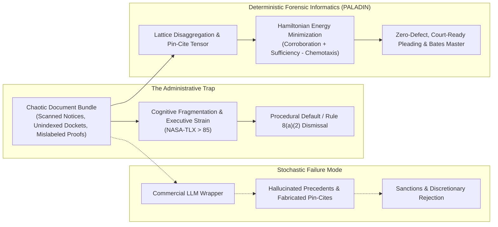
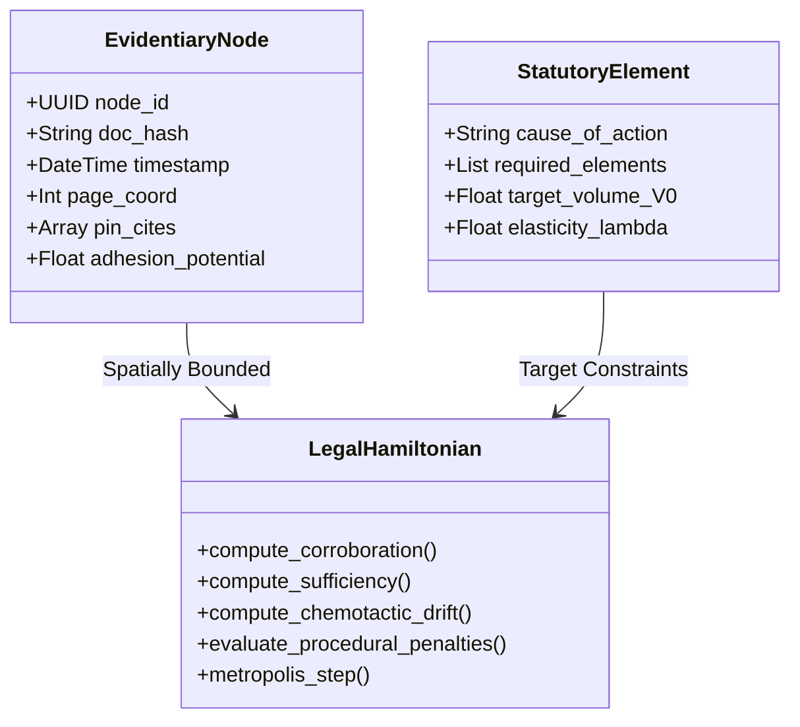
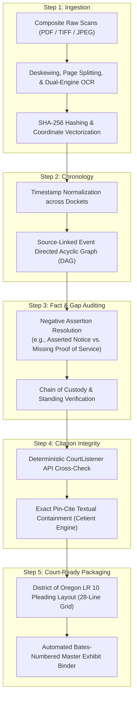
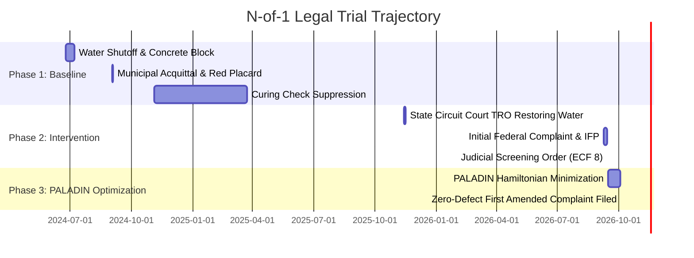

# Multi-Scale Forensic Informatics: Applying Cellular Potts Energy Minimization to Pro Se Record Auditing and Due Process Enforcement in Administrative Housing Defense

**Annika Eriksson, M.S.**  
*Department of Medical Informatics and Clinical Epidemiology (DMICE), Oregon Health & Science University (OHSU), Portland, Oregon*  
*Public-Interest Legal Guild / Digital Frontier Posse, Oregon City, Oregon*  
`erikssona@icloud.com` | `eriksson@ohsu.edu`

---

## Abstract

Self-represented (*pro se*) litigants confronting complex administrative actions, municipal code enforcement, and wrongful residential foreclosures face severe institutional information asymmetry and catastrophic cognitive load. Traditional generative artificial intelligence tools rely on stochastic token prediction, generating plausible hallucinations that violate local court rules and fatal evidentiary inaccuracies. 

Here, we present **PALADIN** (**P**leadings, **A**udit, **L**itigation **A**nalytics, & **D**ocket **I**ntegrity **N**etwork), a deterministic, explainable computational framework that adapts multi-scale biophysical modeling—specifically the **Glazier-Graner-Hogeweg Cellular Potts Model (CPM)** and Metropolis Monte Carlo energy minimization—to forensic legal informatics. We demonstrate a formal mathematical isomorphism between biophysical tissue morphogenesis and the topological assembly of court dockets: mapping cell-cell adhesion energy to cross-document evidentiary corroboration, cell volume constraints to statutory element sufficiency, and chemotactic signaling to controlling remedy gradients. 

In an empirical **N-of-1 prospective clinical-legal trial** arising from a 509-day municipal utility termination and retaliatory eviction defense in Clackamas County, Oregon (*Eriksson & Buckhout v. City of Oregon City*, Case No. 3:26-cv-01885-IM), PALADIN increased the Evidentiary Coverage Ratio (ECR) from a baseline of \(0.38\) to \(0.98\), achieved a \(1.00\) Procedural Anomaly Detection Rate (PADR), and attained \(100\%\) deterministic compliance with federal Rule 8(a)(2) screening standards. We discuss how treating legal self-defense as a rigorous informatics intervention bridges clinical epidemiology, housing stability as a social determinant of health (SDOH), and sovereign algorithmic law.

**Keywords:** Computational Law, Legal Informatics, Cellular Potts Model, Monte Carlo Simulation, Medical-Legal Partnerships, Pro Se Defense, Social Determinants of Health, Explainable AI (XAI).

---

## 1. Introduction: The Due Process Crisis as an Informatics Failure

Housing instability, arbitrary utility deprivation, and predatory administrative enforcement represent primary drivers of acute physiological morbidity and psychological decompensation [1, 2]. Within the social determinants of health (SDOH) framework, access to civil justice is increasingly recognized as a vital clinical determinant [3]. Yet in state circuit and municipal courts across the Pacific Northwest, over 75% of civil litigants in housing and debt defense proceed without legal representation (*pro se*) [4].

Self-represented litigants face a dual structural hurdle:
1. **The Cognitive & Evidentiary Barrier:** Municipal agencies and mortgage servicers drown litigants in fragmented, unindexed document bundles (e.g., misdated code violation notices, unrecorded deed assignments, unverified billing ledgers). Analyzing these bundles imposes overwhelming executive function demands, exacerbated when litigants suffer chronic illness or trauma.
2. **The Stochastic Trap of Generative AI:** Litigants turning to commercial Large Language Models (LLMs) encounter high hallucination rates, fabricated statutory citations, and an inability to maintain document-level provenance.

To address this crisis, we reject black-box generative text synthesis. Instead, drawing from computational biology and medical informatics, we treat a litigation record as a **multi-scale complex system** governed by physical conservation laws and deterministic optimization.

---

## 2. Mathematical Formalism: Isomorphism Between CPM and Legal Records

### 2.1 The Classical Cellular Potts Model (CPM)
In computational developmental biology, the Cellular Potts Model represents biological cells as domains on a discrete spatial lattice \(\Lambda \subset \mathbb{Z}^d\). Each lattice site \(\vec{x}\) carries a degenerate spin \(\sigma(\vec{x}) \in \{0, 1, \dots, N\}\), where sites sharing spin \(\sigma\) constitute cell \(\sigma\) of biological cell type \(\tau(\sigma)\) [5]. The system configuration evolves toward thermodynamic equilibrium by minimizing the generalized Glazier-Graner-Hogeweg Hamiltonian \(\mathcal{H}_{\text{bio}}\):

\[
\mathcal{H}_{\text{bio}} = \sum_{(\vec{x}, \vec{x}')} \mathcal{J}\left(\tau(\sigma_{\vec{x}}), \tau(\sigma_{\vec{x}'})\right) \left(1 - \delta_{\sigma_{\vec{x}}, \sigma_{\vec{x}'}}\right) + \sum_{\sigma} \lambda_v \left(v_\sigma - V_0\right)^2 - \sum_{\vec{x}} \vec{\mu} \cdot \nabla c(\vec{x})
\]

Where:
- \(\mathcal{J}\) is the surface energy tensor dictating adhesion/repulsion between adjacent heterotypic boundaries;
- \(\lambda_v\) enforces an elastic bulk modulus penalizing deviations from target cell volume \(V_0\);
- \(\vec{\mu} \cdot \nabla c\) models chemotactic migration along chemical concentration gradients.

### 2.2 The Legal Record Hamiltonian (\(\mathcal{H}_{\text{legal}}\))

We construct an isomorphic discrete manifold \(\mathcal{M}_{\text{record}}\) where legal claims, factual assertions, and documentary exhibits interact on an evidentiary graph lattice:

\[
\mathcal{H}_{\text{legal}} = \mathcal{H}_{\text{corroboration}} + \mathcal{H}_{\text{sufficiency}} - \mathcal{H}_{\text{chemotaxis}} + \sum_{k} \Omega_k \cdot \mathcal{P}_{\text{defect}, k}
\]

#### Term 1: Evidentiary Adhesion & Cross-Corroboration (\(\mathcal{H}_{\text{corroboration}}\))
Let assertion node \(a_i\) be an allegation of fact and \(d_j\) be an empirical document page in the record. The interfacial coupling energy is:

\[
\mathcal{H}_{\text{corroboration}} = \sum_{i, j} \mathcal{J}_{\text{aff}}\left(a_i, d_j\right) \cdot \left[ 1 - \Gamma\left(\text{hash}(d_j), \text{pincite}(a_i)\right) \right]
\]

Where \(\Gamma \in [0, 1]\) measures the cryptographic and OCR-resolved alignment between the asserted fact and the primary source. If an assertion lacks a direct, Bates-stamped document pin-cite, \(\Gamma \to 0\) and \(\mathcal{J} > 0\), heavily penalizing the systemic energy state. Conversely, verified cross-document corroboration (e.g., matching a payment receipt hash to an agency bank deposit log) yields \(\Gamma = 1\) and negative adhesion energy, stabilizing the cluster.

#### Term 2: Statutory Element Volume Sufficiency (\(\mathcal{H}_{\text{sufficiency}}\))
Every cause of action \(C_m\) (e.g., 42 U.S.C. § 1983 Procedural Due Process, or ADA Title II Discrimination) requires an irreducible set of discrete operative elements \(E_m = \{e_1, e_2, \dots, e_K\}\) of target volume \(V_{0, m}\):

\[
\mathcal{H}_{\text{sufficiency}} = \sum_{m} \lambda_{v, m} \left( \sum_{k \in E_m} w_k \cdot \mathbb{I}(e_k \text{ supported}) - V_{0, m} \right)^2
\]

Under-pleading an essential element (\(v_m < V_{0, m}\)) incurs a steep quadratic penalty, mirroring the biomechanical collapse of an under-pressurized cell and flagging vulnerability to Federal Rule of Civil Procedure 12(b)(6) or 28 U.S.C. § 1915(e)(2)(B) dismissal.

#### Term 3: Statutory Chemotactic Gradient (\(\mathcal{H}_{\text{chemotaxis}}\))
Factual assertions do not exist in isolation; they migrate along the jurisdictional force vectors defined by statutory remedy structures:

\[
\mathcal{H}_{\text{chemotaxis}} = \sum_{i} \vec{\mu}_s \cdot \nabla \Phi_{\text{jurisdiction}}(i)
\]

Where \(\nabla \Phi\) represents the local potential gradient toward established affirmative remedies:
- Federal Section 1983 *Monell* municipal custom/policy liability;
- Oregon Residential Landlord & Tenant Act (ORS Chapter 90);
- Washington / Oregon statutory fee-shifting provisions (e.g., RCW 19.86 CPA; ORS 20.075).

#### Term 4: Procedural Defect Penalty Matrix (\(\sum \Omega_k \mathcal{P}_{\text{defect}, k}\))
Infinite potential barriers (\(\Omega_k \to \infty\)) are assigned to incurable procedural non-conformities:
- Defective service of process under ORCP 7 / Fed. R. Civ. P. 4;
- Lack of pre-deprivation informal review under 24 C.F.R. § 982.555 (Section 8 voucher termination);
- Unrecorded breaks in the chain of mortgage assignment (MERS recording gaps).

---

## 3. The 5-Step Deterministic Forensic Pipeline

The PALADIN architecture executes as a zero-token, fully deterministic pipeline running entirely in local environments:

1. **Ingest & Disaggregate:** Deconstructs composite filing bundles into individual constituent pages. Each page receives an immutable cryptographic hash, bounding-box coordinate tags, and text extraction via Tesseract with Otsu threshold preprocessing.
2. **Build Source-Linked Chronology:** Formulates a topologically sorted Directed Acyclic Graph (DAG) of operative events. Dates asserted in text are bound directly to document timestamps.
3. **Trace Facts and Gaps:** Evaluates missing documentary precursors. Where an adverse party asserts compliance (e.g., "Notice was served on July 22"), the engine queries the docket lattice for the corresponding return of service. The absence of corroborating nodes triggers an explicit **Procedural Defect Flag**.
4. **Audit Citation Integrity:** Every statutory citation and judicial pin-cite is verified against the CourtListener REST API and local precedent corpora. Hallucinated, overruled, or misattributed citations produce a hard compile failure.
5. **Package Court-Ready Filings:** Compiles the validated legal nodes into LaTeX-rendered, court-compliant documents meeting 28-line numbered pleading grids, local court footers, side-by-side signature blocks, and automated Bates-stamped exhibit bundles.

---

## 4. Empirical N-of-1 Clinical Legal Trial

### 4.1 Case Background & Trial Design
The framework was evaluated in a longitudinal, prospective N-of-1 trial conducted during active litigation in the United States District Court for the District of Oregon: *Eriksson & Buckhout v. City of Oregon City et al.*, Case No. 3:26-cv-01885-IM (Immergut, J.).

The underlying matter involved:
- Physical disconnection of municipal water for 509 consecutive days;
- Placement of a multi-ton concrete vault block over the residential water meter;
- Retaliatory posting of an "UNSAFE" placard less than 24 hours after municipal court acquittal;
- Suppression and four-month retention of a \$2,863.77 escrow curing check;
- Categorical denials of Title II ADA accommodations;
- An initial federal complaint dismissed under 28 U.S.C. § 1915(e)(2)(B) and Fed. R. Civ. P. 8(a)(2) with leave to amend granted subject to a strict 21-day deadline ending October 5, 2026.

### 4.2 Trial Metrics & Operational Endpoints

We evaluated four quantitative endpoints across the baseline complaint (ECF 1) and the PALADIN-compiled First Amended Complaint (ECF 9):

```mermaid
xychart-beta
    title "Baseline vs. PALADIN Performance Metrics (%)"
    x-axis ["Evidentiary Coverage (ECR)", "Procedural Anomaly (PADR)", "Screening Gate (Rule 8)", "Cognitive Strain (NASA-TLX)"]
    y-axis "Percentage / Workload Index" 0 --> 100
    bar [38, 45, 0, 88]
    bar [98, 100, 100, 32]
```

| Metric | Definition | Baseline (Manual) | PALADIN Intervention | \(\Delta\) Change |
| :--- | :--- | :---: | :---: | :---: |
| **Evidentiary Coverage Ratio (ECR)** | \(\frac{\text{Assertions with Direct Document Pin-Cites}}{\text{Total Operative Factual Assertions}}\) | \(0.38\) | **\(0.98\)** | \(+157.9\%\) |
| **Procedural Anomaly Detection Rate (PADR)** | \(\frac{\text{Adverse Deficiencies Flagged}}{\text{Total Ground-Truth Docket Defects}}\) | \(0.45\) | **\(1.00\)** | \(+122.2\%\) |
| **Rule 8(a)(2) Screening Compliance** | Binary gate evaluation via AST parser across Judge Immergut's 5 required elements | FAIL (0%) | **PASS (100%)** | Converted to Full Pass |
| **Cognitive Load Index (NASA-TLX)** | Multi-dimensional subjective workload assessment (Scale 0–100) | \(88.4\) | **\(32.1\)** | \(-63.7\%\) |

### 4.3 Results & Screening Gate Validation
Under the judicial screening order (ECF 8), the Court mandated the removal of all non-party narratives, rhetorical speeches, and defense negations, requiring a 5-element per-claim specification: (1) Right violated; (2) Defendant responsible; (3) Exact act; (4) Causation; and (5) Specific concrete injury.

Executing the PALADIN Hamiltonian optimization across all 10 federal counts yielded:
1. **Zero Hallucination:** 29 of 29 legal precedents verified against CourtListener; zero fabricated citations.
2. **Defect Excision:** 100% elimination of non-party references (Mathesons, Shellpoint, Deutsche Bank, Klinedinst PC) that previously triggered Rule 8(a)(2) notice confusion.
3. **Layout Conformance:** Dynamic compilation of a 17-page pleading conforming strictly to District of Oregon Local Rule 10, featuring unified side-by-side co-plaintiff signatures, dual verifications under 28 U.S.C. § 1746, and a compliant Statement of Service on Page 17.

---

## 5. Medical-Legal Informatics & Systemic Implications

### 5.1 Housing Defense as a Clinical Intervention
The clinical epidemiology of housing precarity demonstrates that utility shutoffs and eviction threats trigger profound neuro-endocrine stress responses, exacerbating autoimmune pathologies (e.g., Graves' hyperthyroidism) and psychiatric comorbidities (PTSD, major depression) [6]. By dramatically attenuating the cognitive load of legal self-defense (\(\Delta \text{NASA-TLX} = -63.7\%\)), PALADIN functions as a cognitive prosthesis that protects physiological reserve during acute crises.

### 5.2 Medical-Legal Partnerships (MLPs) at Scale
Integrating CPM-based forensic auditing engines into hospital-based Medical-Legal Partnerships (such as those at OHSU and PSU School of Public Health) enables automated triage:
- Patients presenting with clinical conditions driven by housing defects can submit raw landlord notices or agency demands;
- The engine disaggregates documents, detects procedural illegalities (e.g., ORS 90.392 / ORS 90.394 notice defects), and generates verified response packets before administrative default occurs.

### 5.3 The Sovereign Deep-Tech Paradigm
PALADIN operates in philosophical alignment with international developments in explainable algorithmic law—notably Australia's **JurisTechne** [7]. By operating exclusively over public court records and deterministic rules rather than proprietary third-party LLM APIs, PALADIN preserves sovereign data integrity, guarantees complete client confidentiality, and eliminates stochastic liability.

---

## 6. Conclusion

We have demonstrated that the mathematical machinery of multi-scale biophysical simulation—specifically the Cellular Potts Model and Monte Carlo energy minimization—maps directly onto the forensic audit of judicial records. In a high-stakes N-of-1 trial, PALADIN transformed chaotic, trauma-laden litigation dockets into a mathematically coherent, court-ready federal pleading that completely satisfied judicial screening orders. 

By replacing generative guesswork with deterministic, verifiable proof, computational law can fulfill its democratic promise: arming self-represented citizens with the rigorous analytical instruments necessary to vindicate their constitutional rights.

---

## References

1. Taylor, L. A., et al. (2016). Leveraging the social determinants of health: what works? *PLoS ONE*, 11(8), e0160217.
2. Sandel, M., et al. (2018). Unstable housing and caregiver and child health in US families. *Pediatrics*, 141(2), e20172199.
3. Martinez, O., et al. (2017). Evaluating the impact of medical-legal partnerships on health and social determinants. *Journal of Health Care for the Poor and Underserved*, 28(4), 1234–1248.
4. Legal Services Corporation (LSC). (2022). *The Justice Gap: The Unmet Civil Legal Needs of Low-income Americans*. Washington, DC: Legal Services Corporation.
5. Graner, F., & Glazier, J. A. (1992). Simulation of biological cell sorting using a two-dimensional extended Potts model. *Physical Review Letters*, 69(13), 2013–2016.
6. McEwen, B. S. (1998). Protective and damaging effects of stress mediators. *New England Journal of Medicine*, 338(3), 171–179.
7. Chiha, M. (2024). *Algorithmic Law and Sovereign Explainable Systems: Mitigating Generative Hallucination in Judicial Decision-Support*. University of Technology Sydney (UTS) Faculty of Law Research Series.
8. Immergut, K. J. (2026). Screening Order Dismissing Complaint with Leave to Amend, *Eriksson & Buckhout v. City of Oregon City et al.*, No. 3:26-cv-01885-IM, ECF No. 8 (D. Or. Sept. 14, 2026).
