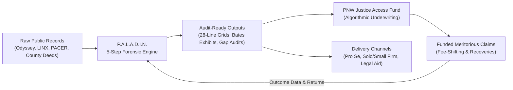
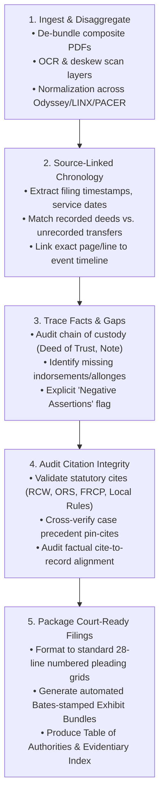
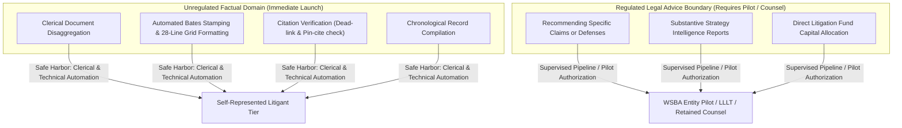
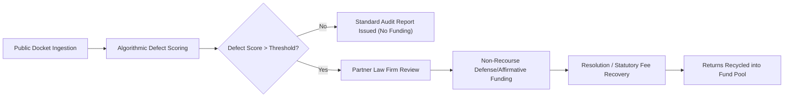
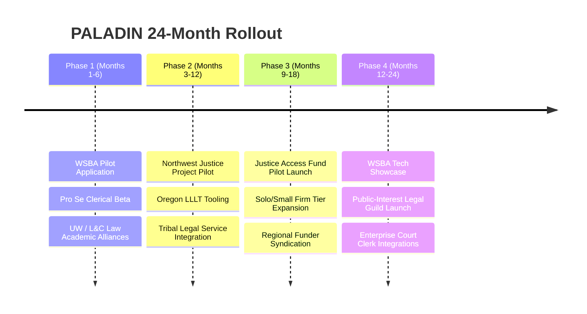

# P.A.L.A.D.I.N. Pacific Northwest Strategic Playbook & Execution Blueprint
**Positioning, Regulatory Architecture, Operational Pipeline & Litigation Fund Model**

---

## Executive Summary

P.A.L.A.D.I.N. (**P**leadings, **A**udit, **L**itigation **A**nalytics, & **D**ocket **I**ntegrity **N**etwork) is positioned as the **Pacific Northwest's Record-First Legal Rescue**. Adapting the proven deep-tech and litigation-fund playbook of Sydney-based **JurisTechne** to the legal, procedural, and regulatory ecosystem of Washington and Oregon, PALADIN replaces generative AI speculation with deterministic, verifiable forensic document auditing.

---

## 1. Comparative Analysis: JurisTechne vs. PALADIN PNW

| Vector | JurisTechne (Australia) | PALADIN (Pacific Northwest) | Strategic Advantage / Rationale |
| :--- | :--- | :--- | :--- |
| **Core Value Proposition** | Explainable Strategy Intelligence Report (XAI) mapping merits & quantum | Forensic Docket Audit & Court-Ready Evidence Verification | Starts from the *docket and document bundle* rather than abstract legal theories; catches missing chains of title and procedural fraud. |
| **Primary Data Source** | Natural Legal Sets (Sovereign ownership, zero data export) | Public Court Dockets (Tyler Odyssey, Pierce County LINX, PACER, County Recorders) | Zero reliance on proprietary/confidential client disclosures; instantaneous deployment using public records. |
| **Regulatory Conduit** | Australian legal regulatory framework (ESIC approved) | WSBA Entity Regulation Pilot Project & Oregon Limited-Scope Paralegal Licensing | Direct pathway to operate an integrated legal tech + fund model without UPL exposure. |
| **Financial Engine** | Algorithmic Litigation Fund (Exclusive subscriber deployment) | PNW Justice Access Fund (Foreclosure defense, consumer protection, civil rights) | Monetizes meritorious claims via statutory fee-shifting (e.g., WA CPA RCW 19.86; ORS 20.075) and defense settlements. |
| **Courtroom Readiness** | Strategic Briefs & Case Law Pathway Maps | 28-Line Pleading Paper, Local Rule Footers, Bates Exhibit Bundles | Direct compliance with King County LCR 10, Pierce County LAR 10, Multnomah County SLR 13. |

---

## 2. The 5-Step Forensic Audit Pipeline

### Technical Deliverables per Matter
1. **Forensic Docket Audit Report (FDAR)**:
   - High-level merit score (0–100) based on record completeness and procedural adherence.
   - Chronological event matrix with direct document-page backlinks.
   - Identified procedural defects (e.g., lack of notice under RCW 61.24.030, defective assignment, expired statutes of limitations).
2. **Verified Evidentiary Binder**:
   - Master PDF with sequential Bates numbering (`[CASE_ID]-[EXHIBIT_ID]-[PAGE]`).
   - Automated Exhibit Slip-Sheets and dynamic Bookmarked Index.
3. **Pleading Draft Companion**:
   - Native LaTeX / DOCX template conforming to Washington Superior Court (28 lines/page, 1-inch margins) or Oregon Circuit Court formatting rules.

---

## 3. Regulatory Alignment: Navigating UPL in WA & OR

> [!IMPORTANT]
> The primary existential risk for any consumer-facing legal technology platform is the Unauthorized Practice of Law (UPL). PALADIN's architectural separation between **factual verification** and **legal advice** ensures strict compliance while preparing for the WSBA Entity Regulation Pilot.

### Strategic Safe Harbors
1. **Factual vs. Evaluative Scaffolding**: 
   - PALADIN outputs report: *"Document #14 asserts notice was served on 2024-03-01. The docket contains no proof of service for Document #14."*
   - Avoids: *"Defendant failed to effectuate proper service under CR 4; you should file a Motion to Dismiss."*
2. **WSBA Entity Regulation Pilot Project**:
   - Target participation in the inaugural application cohort (targeted opening Q4 2025/2026).
   - Leverages Washington Rule of Professional Conduct (RPC) 5.9 mechanisms to allow non-lawyer equity investment and tech-driven delivery.
3. **Oregon Paralegal Licensing Integration**:
   - Equip licensed Oregon legal paraprofessionals (specialized in landlord-tenant and family law) with PALADIN licenses as their primary back-office analysis engine.

---

## 4. The PNW Justice Access Fund: Underwriting Matrix

The Litigation Fund flywheel operates by identifying cases where public court records reveal catastrophic evidentiary defects in the opposing party's claims (e.g., mortgage servicers, predatory debt collectors, municipal code overreach).

### Underwriting Rubric for Foreclosure & Consumer Debt (PNW Focus)

| Evaluation Factor | High Viability (Underwrite) | Moderate Viability | Reject / Disqualify |
| :--- | :--- | :--- | :--- |
| **Chain of Title Integrity** | Missing indorsement, broken allonge sequence, unrecorded MERS gap. | Corrected assignment filed post-default with notary discrepancies. | Unbroken chain of title with original wet-ink note lodged in court registry. |
| **Statutory Notice Compliance** | Complete absence of Notice of Default / Foreclosure Fairness Act mediation offer (RCW 61.24). | Notice sent to non-primary residence or timed within ambiguous window. | Documented certified mail return receipt signed by borrower. |
| **Fee-Shifting Potential** | Clean claims under Washington Consumer Protection Act (RCW 19.86) or Fair Debt Collection Practices Act (FDCPA). | Defective notice allowing attorney fee claim under contract provisions. | Defenses limited to equitable delay without statutory fee-shifting mechanisms. |
| **Procedural Timeliness** | Motion to Vacate under CR 60(b)(5) for void judgment (lack of personal jurisdiction). | Contested motion on statute of limitations (RCW 4.16.040). | Untimely filings past substantive statutes of repose without tolling argument. |

---

## 5. Phased Go-To-Market Execution Plan

### Strategic Milestones
- **Month 3**: Finalize UPL-compliant disclaimers and file petition for WSBA advisory opinion regarding automated docket citation and gap verification.
- **Month 6**: Launch the Self-Represented Litigant Tier ($299/audit) focusing on King, Pierce, and Multnomah County foreclosure and unlawful detainer dockets.
- **Month 9**: Syndicate the seed capital pool (\$1.5M–\$3M) for the PNW Justice Access Fund in partnership with regional impact investors and legal aid networks.
- **Month 15**: Formal integration of the 28-line pleading generator into Clio and MyCase marketplaces for PNW practitioners.

---

## 6. Key Strategic Recommendations & Next Steps

> [!TIP]
> Prioritize building the **"Defect Finder" module** for Deed of Trust / Chain of Title audits first. Foreclosure defense produces the highest concentration of verifiable, public-record evidentiary breaks where statutory fee shifting (RCW 61.24 / RCW 19.86) guarantees commercial viability.

1. **Formalize Product Disclaimers**: Draft terms ensuring pro se users clearly acknowledge PALADIN as a forensic record auditing tool rather than legal representation.
2. **Standardize Tyler Odyssey / LINX Scrapers**: Finalize parsers for King County Script/E-Filing, Pierce County LINX, and Oregon OECI to automate raw filing de-bundling.
3. **Engage WSBA Regulatory Sandbox Advisors**: Schedule exploratory discussions with members of the WSBA Legal Technology Task Force to ensure PALADIN's framework aligns directly with forthcoming pilot guidelines.
